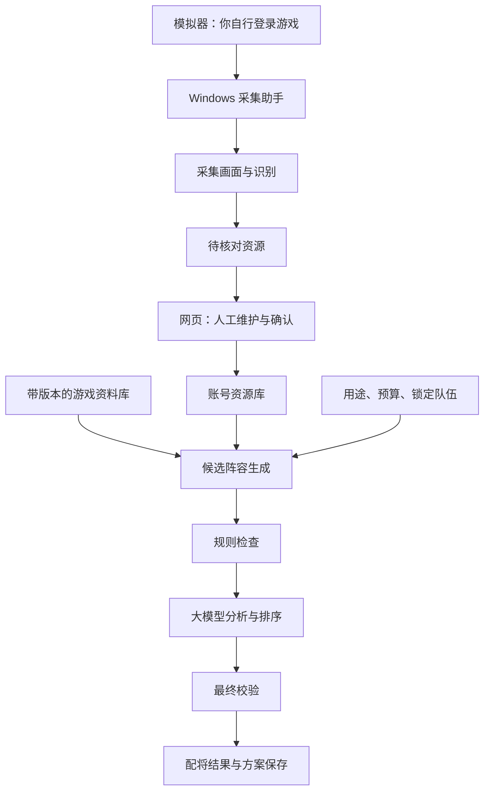

# 对话记录

范围：本次聊天开始至用户要求保存记录并推送 GitHub 的消息（含该消息）。保留当前会话文件中的用户正文、助手答复和进度说明；保留原文中的历史判断，它们不代表已验证事实。排除系统/开发者指令、内部推理及自动注入的环境和页面状态。时间统一展示为上海时区。

## 1. 用户 · 2026-10-28 09:49:05 +08:00

我是一名率土之滨玩家，我想让你给我智能配将，我怎么才能让你给我配将？


## 2. 助手 · 2026-10-28 09:51:05 +08:00

可以。你把**武将、战法和当前赛季**发给我，我就能按你的账号资源配队，并说明站位、战法、加点和替代方案。

最方便的方式是直接发截图，尽量包含：

- **武将库**：有哪些武将，等级、进阶情况能看清最好；武将多就分几张发。
- **战法库**：已拥有的战法，以及可用数量、研究进度；没解锁的不要混在一起。
- **当前赛季**：S1、S2、S3或征服赛季，最好带上具体剧本。
- **配队目标**：开荒、打架、攻城，还是整理整个账号的主力队。
- **限制和偏好**：例如必须用某个武将、某队不想拆、资源只够养一队。

我会优先考虑**你实际能组出来、战法不冲突、培养成本合适**的阵容，并区分“现在就能用”和“以后补齐再用”的方案。涉及当前版本的武将、战法改动，我会先核对资料。

你可以复制这段填，也可以直接发截图：

> 当前赛季／剧本：  
> 主要目标：  
> 想配几队：  
> 武将和战法：见截图／文字列表  
> 现有队伍：  
> 必须保留或想用的武将：  
> 其他限制：

**先发武将库、战法库截图，再告诉我赛季和用途，就可以开始。**

## 3. 用户 · 2026-10-28 09:51:31 +08:00

你能直接配将吗？通过连接的方式，不要通过截图呢？


## 4. 助手 · 2026-10-28 09:51:37 +08:00

我先查一下有没有能直接读取游戏账号阵容的连接方式。

## 5. 助手 · 2026-10-28 09:51:46 +08:00

我会用插件管理功能查找《率土之滨》相关连接。

## 6. 助手 · 2026-10-28 09:51:59 +08:00

**可以帮你配将，但目前我这边没有能直接连接《率土之滨》账号、自动读取武将和战法的接口。**我刚查了可用插件，没有找到对应连接；你也可以在[插件目录](https://chatgpt.com/plugins)查看是否有其他选项。

如果你不想手动截图，可以考虑：

- **电脑上查看游戏**：如果你的客户端或模拟器能被当前电脑控制功能访问，我可以尝试直接查看武将库、战法库，你不用逐张截图上传。具体能否读取，要先检查窗口。
- **读取导出数据**：如果你使用的游戏工具能导出武将、战法列表，我可以直接读取文件配队。

你现在是在**手机、电脑客户端，还是电脑模拟器**上玩？如果在电脑上，我们可以先检查能否直接查看。

## 7. 用户 · 2026-10-28 09:52:14 +08:00

手机上


## 8. 助手 · 2026-10-28 09:52:23 +08:00

那目前**我不能直接连接你的手机游戏，自动读取账号里的武将和战法**。

如果不想截图，可以用手机语音输入，告诉我：

> 我是××赛季，想配打架队。  
> 五星武将有：……  
> 已有战法有：……

**不用一次报全。**先说你想用的核心武将和几个主要战法，我先配一版，再根据缺少的信息补齐。

如果你用的配将工具支持导出账号阵容或生成分享链接，也可以发给我，我会检查能否读取。不要发送账号密码或验证码。

## 9. 用户 · 2026-10-28 09:58:15 +08:00

我想让你帮我写一个可以在电脑上用模拟器然后你能够识别登陆账号的武将和战犯宝物赛季，基于大模型进行智能配将可以实现吗？


## 10. 助手 · 2026-10-28 09:58:24 +08:00

可以实现。我先核对模拟器读取画面和大模型识别的接入方式，再给你一个可落地的方案。

## 11. 助手 · 2026-10-28 09:58:37 +08:00

我也会参考 OpenAI 官方文档，确认大模型读取游戏画面的能力和限制。

## 12. 助手 · 2026-10-28 09:59:21 +08:00

**可以实现，我可以帮你开发。**目标是做一个 Windows 配将助手：你在模拟器里登录游戏，点击“扫描账号”，软件自动整理武将、战法、宝物和赛季信息，再根据你的资源生成配队方案，你不用手动截图上传。

不过，要分清两个问题：**读取账号资源可以通过画面识别实现；配将是否靠谱，需要准确的游戏资料、规则校验和实测。**单靠大模型凭记忆推荐，容易出现不存在的搭配或资源冲突。

建议按下面这个流程做：

| 环节 | 软件做什么 |
|---|---|
| 连接模拟器 | 检测模拟器，连接到你已经登录的游戏 |
| 扫描资源 | 依次打开武将、战法、宝物、赛季页面，自动翻页并采集画面 |
| 整理账号 | 识别名称、等级、进阶、战法研究情况、宝物属性等，去重保存 |
| 核对错误 | 对模糊、缺失或有冲突的信息标记出来，允许你修改 |
| 智能配将 | 结合账号资源、当前版本资料、用途和培养预算生成候选阵容 |
| 输出方案 | 展示站位、战法、宝物、加点、搭配理由及替代方案，并检查多队资源冲突 |

技术上，支持 ADB 的模拟器可以通过它采集屏幕画面；Android 官方提供了相应截图命令。这为自动扫描提供了基础，但具体模拟器和游戏界面仍要适配验证。[Android 官方文档](https://developer.android.com/tools/adb#screencap)

识别部分可以结合文字识别和视觉大模型。视觉模型能分析图片，但小字、图标和复杂画面可能识别错误，因此需要保留原图依据、重复核对和人工修正入口。[OpenAI 官方文档](https://developers.openai.com/api/docs/guides/images-vision)

**配将部分，我建议采用“游戏资料库＋规则校验＋大模型分析”。**

- 资料库提供带版本和来源的武将、战法、宝物及赛季规则。
- 程序检查是否拥有、是否重复占用、是否符合赛季限制。
- 大模型负责比较候选队伍、解释取舍，并根据你的偏好调整。
- 后续可加入战报，辅助评估实际表现；没有验证过的方案不标成“最强”。

第一版适合先支持**一种模拟器、固定分辨率、单账号扫描、数据核对和配队推荐**。你自己完成登录，软件从登录后的游戏页面开始工作。全自动扫描的稳定性，要用你的实际界面测试后才能确认。

开始前，先告诉我两件事：**你准备使用哪一种模拟器（雷电、MuMu 或其他）？这个工具是只给自己用，还是准备给其他玩家也用？**

## 13. 用户 · 2026-10-28 10:01:02 +08:00

扫描资源	依次打开武将、战法、宝物、赛季页面，自动翻页并采集画面 这个精准吗？


## 14. 助手 · 2026-10-28 10:01:26 +08:00

**能做到实用，但不能保证一次扫描就全部准确。**前面说“自动扫描”是实现目标，实际准确率要用你的模拟器和账号测试，不能现在就给你报一个百分比。

这里有两类错误：

| 环节 | 可能出现的问题 | 怎么提高可靠性 |
|---|---|---|
| 自动翻页 | 滑动跳过一行、页面未加载、弹窗挡住 | 翻页保留重叠区域，等待画面稳定，记录已扫描位置 |
| 识别内容 | 名称看错、进阶数错、宝物词条漏读 | 名称与资料库匹配，关键属性进入详情页读取，多次结果交叉核对 |
| 扫描完整性 | 只扫描到部分资源，却显示“完成” | 核对界面中的总数量；无法核对时明确标记“完整性未确认” |
| 赛季信息 | 从界面背景或武将情况推错赛季 | 读取明确写有赛季／剧本的页面，找不到就让你补充 |

**最重要的是：识别正确和没有漏扫，是两回事。**即使已经识别出的武将都对，也可能漏掉几名，所以这两项要分别验证。

我建议做成这样的体验：

1. 先快速扫描列表，建立资源清单。
2. 对配将需要的关键属性，自动打开详情页补充读取。
3. 有疑问的项目显示原图和识别结果，让你只核对这些项目。
4. 配队时使用已核实的数据；缺少信息就明确提示，不自行猜测。

宝物的细小词条、外观相似的图标通常需要重点验证。视觉大模型本身也存在小字识别和描述错误的限制。[OpenAI 官方说明](https://developers.openai.com/api/docs/guides/images-vision)

**开发时应该先做一个小样：扫描你账号的一部分武将、战法和宝物，人工对照，统计漏扫、错认和属性错误。**这一步通过后，再扩展到整个账号，比一开始承诺“一键精准配将”可靠得多。

## 15. 用户 · 2026-10-28 10:01:45 +08:00

有没有办法抓包实现？


## 16. 助手 · 2026-10-28 10:01:51 +08:00

我查一下抓包能读取哪些内容，以及加密通信会带来什么限制，再判断它是否适合这个工具。

## 17. 助手 · 2026-10-28 10:02:21 +08:00

**有办法尝试，而且如果能解析出完整的账号数据，通常会比画面识别更准确。**但“抓到网络包”和“读出武将、战法、宝物”是两件事，目前还不能承诺《率土之滨》一定能用这条路线。

主要有三个关卡：

1. **通信加密**：抓包可能只能看到加密内容。Wireshark 解密 TLS 通常需要相应的会话密钥；代理抓包也取决于客户端是否信任代理证书，证书固定可能导致连接失败。[Wireshark 文档](https://wiki.wireshark.org/TLS/)、[mitmproxy 文档](https://docs.mitmproxy.org/stable/concepts/certificates/)
2. **数据格式**：即使能看到内容，也可能是二进制协议、压缩数据或额外加密，需要确认字段含义，不能把某个数字直接猜成武将编号或进阶数。
3. **数据完整性**：游戏可能在进入不同页面时分批加载资源，因此不一定登录一次就能拿到全部武将、战法和宝物。

**对你的工具，我建议先做“抓包可行性验证”，再决定正式开发路线：**

- 在你自己的模拟器和账号上，记录进入游戏、打开武将库、战法库、宝物页时的网络通信。
- 检查能否读取响应，找出与资源页面对应的数据。
- 用游戏界面逐项核对名称、数量、属性和赛季，确认解析正确且没有漏项。
- 验证通过后，做成本地资源清单，再交给配将模块；无法读取的部分用画面识别补充。

大模型适合接收**整理好的账号资源和游戏资料**，无需把登录凭证、令牌或原始网络包发送给它。

**所以结论是：值得先试，但需要实测后才能判断能否替代截图扫描。**我还没有验证《率土之滨》当前客户端的协议，也不能保证这类工具符合游戏规则或没有账号风险。

你准备用**雷电还是 MuMu 模拟器**？确定后，就可以先做最小验证。

## 18. 用户 · 2026-10-28 10:03:36 +08:00

率土之滨有官方的连接可以实现吗？


## 19. 助手 · 2026-10-28 10:03:42 +08:00

我查一下网易和《率土之滨》官方是否提供账号资源查询接口或开发者接入。

## 20. 助手 · 2026-10-28 10:04:30 +08:00

**目前我没有查到《率土之滨》公开提供、能让第三方软件经玩家授权读取武将、战法、宝物和赛季的官方 API。**因此，现在不能承诺通过“官方连接”实现你的配将工具。公开检索也无法排除网易存在未公开的合作接口。

需要区分：

- **官方工具能绑定角色、查看数据**：不代表允许我们开发的软件调用这些数据。
- **抓包发现游戏接口**：也不等于官方开放接口，没有公开接入文档和授权，就不能当作稳定的官方连接。

最值得先做的是通过[《率土之滨》官网](https://stzb.163.com/)或游戏内客服，询问这一段：

> 我想开发一个玩家自行授权使用的智能配将工具，仅需读取角色的武将、战法、宝物及赛季信息。请问是否有官方开放 API、开发者合作申请渠道，或账号资源导出功能？是否允许第三方工具接入？

**在官方明确回复前，开发方案应该保留“资源导入／模拟器画面识别”作为基础，把官方接口作为待确认的接入方式。**这样不会因为接口拿不到，导致整个工具无法使用。

## 21. 用户 · 2026-10-28 10:08:54 +08:00

**. 网易游戏App（数据抓包）**\
这是一个在技术社区中被讨论的方法。网易游戏App内设有《率土之滨》专区，包含基础的武将库、战法库以及社区配将数据。有开发者分享经验称，可以通过**抓取该App的网络请求包**来获取这些数据。这本质上是一种逆向工程手段，并非官方提供的规范接口，其稳定性和合规性都依赖于官方的容忍度。
**2. 官方藏宝阁（角色交易平台数据）**\
藏宝阁是网易官方认证的角色交易平台，其数据直接来自游戏，真实可信。在藏宝阁上查看待售角色时，页面会详细展示该角色的**武将、战法、宝物、典藏**等信息。有开发者曾利用这一点，通过爬取藏宝阁的公开页面来构建账号价值分析模型，其中就包含了获取“玉符、武将、战法等”属性集的功能。但这同样是一种**网页抓取**行为，而非调用官方API。这来两个方案可以吗？


## 22. 助手 · 2026-10-28 10:09:02 +08:00

这两条路线都值得评估，关键是能否拿到你本人账号的完整资源。我先核对藏宝阁的展示范围，以及网易相关 App 的资料库和账号数据有什么区别。

## 23. 助手 · 2026-10-28 10:09:48 +08:00

**这两个方案都可以作为候选，但用途不同：藏宝阁适合验证“角色资源导入”，App 抓包是否能读取你自己的完整账号，还需要实测。**

也补充一下我前面的结论：**没有找到公开官方 API，不代表无法从官方页面或 App 获取数据。**但后者也不能直接称为“官方授权接入”。

| 方案 | 对你的工具有什么用 | 关键条件 |
|---|---|---|
| 网易相关 App 抓包 | 获取武将、战法资料，可能获取绑定角色的资源 | 必须确认 App 实际返回的是“你拥有的资源”，而不是全游戏图鉴 |
| 藏宝阁角色详情 | 从一个角色链接导入其展示的武将、战法、宝物等 | 只能导入该页面可访问、实际展示的数据，需要检查是否完整及更新及时 |

**第一种方案，最关键的是区分“图鉴”和“我的仓库”。**  
全游戏武将库可以帮助大模型理解武将，但不能告诉它你拥有哪些武将、几次进阶、哪些战法已研究、宝物有什么词条。即使 App 支持角色绑定，也不能据此认定它会返回全部资源。另外，你提到的“网易游戏 App”具体是哪款，需要有准确名称或链接。

**第二种方案，如果角色详情数据确实完整，我会优先用它做原型。**  
可以设计成“粘贴藏宝阁角色链接 → 解析页面数据 → 核对资源 → 智能配将”。它能减少画面识别错误，但仍要验证：

- 宝物是否包含完整词条，战法是否包含配将需要的状态。
- 数据是否只是某个时间点的快照。
- 你的自用账号没有交易展示链接时，是否仍有可用的查看入口。

**不建议为了导入资源而把你的角色上架。**藏宝阁方案能支持待售角色分析，也未必能解决你日常游戏账号的持续同步。

我刚才未能直接打开藏宝阁官方页面，因此你提供的“详细字段范围”和开发者经验，目前还没有被我独立验证。**你可以先发一条正常可访问的藏宝阁角色分享链接，以及所说 App 的准确名称或经验文章链接；我就能进一步检查哪条路线能真正满足你的需求。**

## 24. 用户 · 2026-10-28 10:24:17 +08:00

那如果不能抓取数据我能不能实现通过扫描资源	依次打开武将、战法、宝物、赛季页面，自动翻页并采集画面之后，如有问题可以手动维护下数据，然后接入大模型读取数据进行配将，打造一个智能的配将平台


## 25. 助手 · 2026-10-28 10:24:48 +08:00

**完全可以，这是一条可落地的路线。**你描述的“自动扫描＋人工校正＋大模型配将”，能把识别不确定的问题控制住，适合做成长期使用的平台。

核心流程可以这样设计：

**模拟器扫描 → 账号资源库 → 人工核对 → 智能配将 → 保存和调整方案**

各部分具体负责：

| 模块 | 功能 |
|---|---|
| 扫描助手 | 在电脑上连接模拟器，打开资源页面、翻页、采集画面，支持暂停和继续 |
| 数据识别 | 提取武将、战法、宝物及赛季信息，保存对应画面作为核对依据 |
| 资源管理 | 用表格或卡片展示资源，支持新增、修改、删除，标记待核对项 |
| 游戏资料库 | 保存带版本、来源的武将机制、战法效果、宝物属性和赛季规则 |
| 配将引擎 | 根据你的资源、用途、队伍数量和培养预算生成候选方案 |
| 规则校验 | 检查资源是否拥有、多队是否冲突、搭配是否符合已录入规则 |
| 方案管理 | 保存阵容，锁定不想拆的队伍，替换缺少的资源并重新推荐 |

**人工维护要作为正式功能来做。**例如：

- 自动扫描没找到某个武将，允许手动补上。
- 宝物词条识别错了，可以对照原图修改。
- 再次扫描时，发现与手动修改的数据不同，展示差异，避免直接覆盖。
- 每条数据记录扫描时间和核对状态；没扫描到的资源，也不能直接当作已删除。

这样，即使扫描尚未做到完全自动，整个平台仍然可以正常使用。

**大模型负责分析，程序负责约束。**大模型读取整理后的账号数据和相关游戏资料，给出阵容与理由；程序再检查是否使用了你没有的战法、是否重复占用了宝物等。发现问题后重新生成，缺少关键属性时提示补充。这样比把所有截图直接交给模型配队更容易维护和验证。

第一版建议先完成一个完整的小闭环：

1. 支持一种模拟器和固定分辨率。
2. 扫描武将、战法、宝物，赛季允许手动选择。
3. 提供资源编辑和核对页面。
4. 接入一个可配置的大模型服务。
5. 生成单队或多队方案，展示站位、战法、宝物、加点建议、替代方案和资源冲突。

第一版的验收重点是：**资源能核对、人工修改能保留、推荐能追溯到账号资源和游戏资料。**配将强度再通过战报逐步评估，不能仅凭模型的解释判断。

如果后续给其他玩家使用，可以扩展成“**电脑采集助手＋网页配将平台**”：电脑助手负责模拟器操作，网页负责资源维护、模型分析和方案管理。前期也可以全部在本机运行，先验证扫描质量和配将效果。

## 26. 用户 · 2026-10-28 10:31:39 +08:00

你帮我生成一下这个部署的方案


## 27. 助手 · 2026-10-28 10:32:51 +08:00

建议先部署成 **“Windows 本地采集助手＋本地配将平台＋可配置大模型 API”**。先用你的账号完成扫描、校正和配将闭环，稳定后再扩展成多人网页版。

第一阶段所有账号资源保存在你的电脑上，配置云端模型时，仅发送配将需要的资源和资料。下面可以直接作为开发、部署方案。

### 1. 整体架构



**采集和配将分开运行。**扫描失败时，仍可手动维护资源、继续配将；模型暂时不可用时，也不会影响账号数据管理。

### 2. 第一版部署位置

| 组件 | 部署在哪里 | 职责 |
|---|---|---|
| 游戏模拟器 | Windows 电脑 | 运行游戏，用户自行登录 |
| 采集助手 | Windows 电脑 | 连接模拟器、截图、翻页、识别页面、断点续扫 |
| 管理网页 | 本机浏览器 | 查看扫描进度、维护资源、配置模型、查看配将结果 |
| 后端服务 | Windows 本机 | 管理账号、扫描任务、配将任务及规则校验 |
| 数据库 | 本机 | 保存账号资源、游戏资料、方案和修改记录 |
| 图片目录 | 本机 | 保存核对用画面，支持按保留策略清理 |
| 大模型 | 通过 API 接入 | 分析候选队伍、解释取舍、提出替代方案 |

本地服务默认只允许本机访问。第一版不需要租服务器，也不需要域名。

### 3. 技术选型建议

以下是开发起点，具体依赖版本在实施时锁定。

| 部分 | 建议选型 | 原因 |
|---|---|---|
| 采集与后端 | Python＋FastAPI | 便于整合模拟器控制、图像处理和模型调用 |
| 前端 | React＋TypeScript | 适合资源表格、人工核对、阵容编辑 |
| 模拟器连接 | ADB，必要时增加窗口采集 | 优先适配一种模拟器 |
| 图像处理 | OCR＋图像匹配＋视觉模型补充 | 分别处理文字、页面定位和疑难内容 |
| 本地数据库 | SQLite | 单人版部署和备份简单 |
| 模型接入 | 可配置服务地址、模型名和密钥 | 方便更换模型服务 |
| 后台任务 | 独立任务进程 | 扫描和模型调用不阻塞管理网页 |

第一版建议使用 **Windows 原生运行采集助手和后端**，减少模拟器连接、文件访问和打包方面的复杂度。

### 4. 数据怎样保存

需要分成三类，避免把“游戏里存在的东西”当成“账号拥有的东西”。

| 数据类型 | 保存内容 |
|---|---|
| 游戏资料 | 武将、战法、宝物定义，效果描述，赛季规则，资料来源与适用版本 |
| 账号资源 | 实际拥有的武将及进阶、战法研究状态、宝物词条、赛季、当前队伍 |
| 配将方案 | 使用的资源、目标用途、推荐理由、校验结果、模型和资料版本 |

每条账号资源还应记录：

- 来源：自动识别或人工录入。
- 最近扫描时间、最近人工确认时间。
- 核对状态及对应画面。
- 修改历史。

**人工确认的数据再次遇到不同识别结果时，进入差异核对，不直接覆盖。**扫描任务未完整结束，也不能据此删除原有资源。

### 5. 扫描流程

第一版按以下方式实现：

1. 检测模拟器连接、分辨率和游戏页面。
2. 用户进入游戏后启动扫描。
3. 按武将、战法、宝物、赛季分别建立任务。
4. 翻页保留重叠区域，去重并记录进度。
5. 对必要属性进入详情页补充采集。
6. 弹窗、页面异常或连续无进展时暂停，保留断点。
7. 扫描结束后展示新增、变化、疑似遗漏和待核对项目。

界面应分别显示 **“任务是否结束”“资源是否扫全”“数据是否核实”**，不能只用一个“扫描成功”概括。

### 6. 配将流程

输入包括账号资源、赛季、开荒／打架等用途、队伍数量、培养预算，以及必须保留的武将或队伍。

处理过程：

1. 从游戏资料库检索相关机制和候选搭配。
2. 根据账号资源形成候选阵容。
3. 程序检查资源占用、数量和已录入的赛季限制。
4. 大模型比较候选方案，给出搭配理由与调整建议。
5. 对模型输出再次检查。
6. 保存通过校验的结果，对缺失资料和未经验证的判断明确标注。

结果包含站位、战法、宝物、加点建议、培养优先级和替代方案。多队配将应统一分配资源，避免每队分别推荐后相互冲突。

**规则校验通过只代表方案满足已实现的约束，不能等同于实战最强。**强度需要后续结合战报验证。

### 7. 安装、运行和备份

目标交付形式：

- 一个 Windows 安装包。
- 一个启动入口，同时启动后台服务并打开管理网页。
- 首次使用引导配置模拟器和模型服务。
- 提供连接测试、扫描测试、模型调用测试。
- 提供数据导出、备份和恢复入口。

建议目录：

```text
配将助手/
├─ app/          程序与前端
├─ config/       本机设置
├─ data/         数据库
├─ captures/     采集画面
├─ backups/      数据备份
└─ logs/         运行日志
```

模型密钥使用系统凭据存储，日志中隐藏密钥和登录凭证。数据库升级前先备份；备份同时覆盖数据库和需要保留的核对图片。

### 8. 开发和验收顺序

| 阶段 | 交付内容 | 验收重点 |
|---|---|---|
| ① 资源管理 | 手动录入、编辑、导入导出 | 数据能保存、修改和恢复 |
| ② 扫描小样 | 一种模拟器，少量资源扫描 | 对照实物统计漏扫、错认、属性错误 |
| ③ 完整采集 | 自动翻页、详情识别、断点续扫 | 能发现异常，人工修改不被覆盖 |
| ④ 智能配将 | 资料库、模型接入、规则校验 | 不凭空使用资源，冲突可检查，理由可追溯 |
| ⑤ 安装交付 | 安装包、引导、备份恢复 | 新环境能完成安装到配将的完整流程 |

先完成资源管理，再增加自动扫描，可以让后面的开发始终有可用的数据和验证入口。

### 9. 多人平台的后续部署

确认单人版有效后，再扩展成：

**用户电脑采集助手 → HTTPS 云端服务 → 网页平台 → 大模型服务**

届时将数据库迁移到 PostgreSQL，图片放入对象存储，扫描上传、识别和配将采用任务队列，并增加用户登录、账号资源隔离、调用额度和数据删除功能。

采集助手主动连接服务器，无需对用户电脑开放入站端口。服务器费用、模型费用和图片存储费用，等实际测出扫描量、调用次数及并发需求后再估算。

**当前推荐实施范围：Windows 单人版、适配一种模拟器、支持资源人工维护、接入一个模型服务、完成单队和多队推荐。**这能先验证最关键的两件事：账号数据是否可靠，配将结果是否值得使用。

## 28. 用户 · 2026-10-28 11:02:35 +08:00

我现在想准备实现这个就在这个项目下，应该怎么做


## 29. 助手 · 2026-10-28 11:02:47 +08:00

我先检查这个项目目录和本机开发环境，再把实施步骤落成项目里的文档和基础目录，方便直接开始开发。

## 30. 助手 · 2026-10-28 11:03:37 +08:00

这个目录目前是空的，Node.js 和 Git 已可用；Python 目前只找到 Windows 的应用别名，ADB 也还没找到。

我先建立项目说明、分阶段任务、数据规范和环境检查脚本。第一步定为“账号资源维护”，随后接模拟器扫描和大模型，便于逐步验证。

## 31. 用户 · 2026-10-28 11:04:15 +08:00

<send_user_message_question_reply>
[{"questionItemId":"[\"request_user_input_async\",\"call_d00169d7cf894eeea44fc7a2a316cb45\",0]","question":"第一版准备适配哪种模拟器？我会先把通用项目结构和开发路线建好。","answer":"MuMu 模拟器"}]
</send_user_message_question_reply>


## 32. 助手 · 2026-10-28 11:06:34 +08:00

已经在 **D:\率土之滨** 建好项目准备骨架，第一版确定适配 **MuMu 模拟器**。

已创建：

- [项目说明与启动准备](D:/率土之滨/README.md)
- [分阶段开发计划与验收标准](D:/率土之滨/docs/IMPLEMENTATION.md)
- [账号资源与扫描数据规范](D:/率土之滨/packages/contracts/README.md)
- [本地配置模板](D:/率土之滨/config/local.example.json)
- [环境检查脚本](D:/率土之滨/scripts/check-environment.ps1)

环境检查已通过执行：Node.js、npm、Git 可用；尚未确认有可运行的 Python，ADB 未加入 PATH，但可能随 MuMu 安装。

接下来按这个顺序实施：

1. **确认 MuMu 环境**：版本、安装位置，以及能否登录手机上的同一角色。
2. **开发资源维护功能**：先支持手动管理武将、战法、宝物和赛季。
3. **接入扫描**：先验证单张画面，再实现翻页、识别和差异核对。
4. **接入大模型**：加入游戏资料、资源冲突检查和配队推荐。

目前完成的是文档、配置和目录准备，扫描及配将功能还未实现。

**你的 MuMu 已经安装了吗？如果已安装，告诉我安装路径或版本号，我们就从连接验证开始。**

## 33. 用户 · 2026-10-28 11:25:35 +08:00

D:\Program Files\YXShuaiTu-12.0 应该是这个位置你查看下


## 34. 助手 · 2026-10-28 11:27:50 +08:00

我先检查这个目录里的程序和 ADB 工具，确认它是不是模拟器安装目录，以及是否有可连接的实例。

## 35. 助手 · 2026-10-28 11:29:37 +08:00

确认了，这是“率土之滨-MuMu模拟器12”的安装目录，自带 ADB；配置中记录的实例连接地址是 `127.0.0.1:16384`。

目前没检测到模拟器进程，ADB 服务也未能启动，所以还没有验证连接。我先把已确认的路径和地址保存到项目配置，之后启动模拟器就能继续检查。

## 36. 助手 · 2026-10-28 11:30:01 +08:00

确认了，这就是 **率土之滨专用的 MuMu 模拟器12** 安装目录。

已找到并记录：

- 模拟器版本：`4.1.42.3773`
- ADB：`D:\Program Files\YXShuaiTu-12.0\shell\adb.exe`
- 配置中的连接地址：`127.0.0.1:16384`

路径已保存到项目配置，检查结果见 [本机 MuMu 记录](D:/率土之滨/docs/MUMU-LOCAL.md)。

**目前没检测到模拟器运行，ADB 服务启动也未成功，因此尚未连接或截图。**你先打开“率土之滨-MuMu模拟器12”，等待启动完成后告诉我，我继续验证连接和画面采集。

## 37. 用户 · 2026-10-28 11:54:36 +08:00

我启动了


## 38. 助手 · 2026-10-28 11:54:42 +08:00

我现在检查模拟器连接；连接成功后读取分辨率并采集一张画面，验证后续识别能否使用。

## 39. 助手 · 2026-10-28 11:55:12 +08:00

连接测试显示，当前运行环境限制了本机端口访问，之前的 ADB 启动失败也可能与此有关。我会申请访问本机模拟器端口，继续做连接和截图验证。

## 40. 用户 · 2026-10-28 11:55:31 +08:00

暂停


## 41. 助手 · 2026-10-28 11:55:37 +08:00

已暂停，不再执行连接或截图操作。

当前结果：ADB 服务已启动，但 MuMu 的 `16384` 端口拒绝连接；发现另一台 ADB 设备，尚未操作它，也未采集画面。

## 42. 用户 · 2026-10-28 12:00:02 +08:00

你把到现在位置的和我对话的所有记录和操作保存到项目的文件下面，然后完成git的初始化然后把所有文件推送到[https://github.com/Xu-Xing1025/stzb.git](https://github.com/Xu-Xing1025/stzb.git)这个仓库里面

